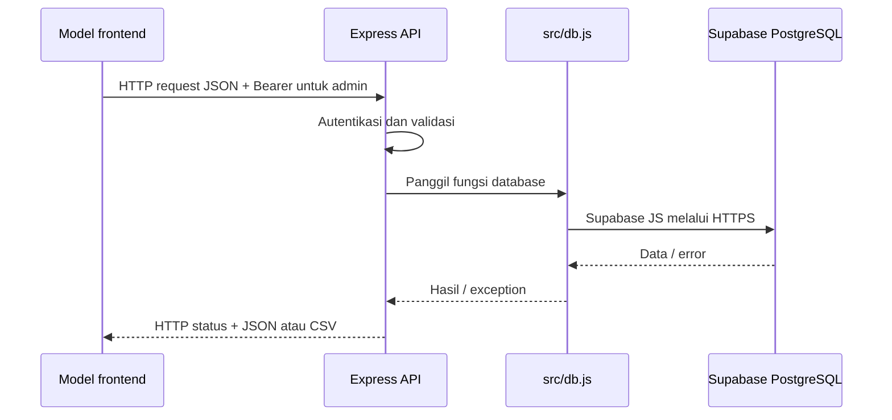

# Ogi Resto Backend

REST API Express untuk katalog catering, pesanan, administrasi menu, rekap kasbon,
dan riwayat pembayaran. Database utama menggunakan Supabase PostgreSQL.
Worker bot grup disediakan terpisah di [whatsapp-bot](whatsapp-bot/README.md).

## Rekening pembayaran

Informasi pembayaran yang ditampilkan kepada pelanggan:

```text
0690595664
BCA
A/n: Ogi Nur Saputra
```

Informasi rekening ditampilkan oleh frontend. Label UI non-Kasbon sekarang
**Cash / Transfer**, sedangkan nilai `payment_method` tetap `Cash` atau `Kasbon`.
Tidak ada kolom bank baru, verifikasi mutasi, webhook bank, atau perubahan schema
yang diperlukan untuk perubahan tampilan ini.

Riwayat pembayaran manual/WhatsApp tetap hanya menyimpan laporan identitas dan
tanggal. Admin mencocokkan transfer ke rekening di atas sebelum mengonfirmasi
pelunasan kasbon. Membuka informasi rekening tidak menandakan transaksi berhasil.

## Struktur

| Lokasi | Tanggung jawab |
| --- | --- |
| `src/server.js` | Routing HTTP, autentikasi, validasi request, dan CSV |
| `src/db.js` | Akses tabel Supabase dan penyimpanan JSON development |
| `src/kasbon.js` | Periode, identitas karyawan, dan agregasi Cash/Kasbon |
| `src/paymentHistory.js` | Validasi manual, parser /bayar, tanggal WIB, dan ID/pagination |
| `src/whatsappWebhook.js` | Challenge Meta dan verifikasi signature webhook |
| `src/seedData.js` | Data menu awal dan daftar hari |
| `schema.sql` | Skema lengkap dan seed instalasi baru |
| `migrations/` | Perubahan untuk database yang sudah ada |
| `tests/` | Pengujian backend |
| `whatsapp-bot/` | Worker Baileys dengan package dan dependensi sendiri |

## Menjalankan

Dari folder backend, gunakan Node.js 22 atau lebih baru bila menjalankan bot:

```powershell
npm.cmd ci
# Hanya pada instalasi baru, jangan menimpa konfigurasi yang sudah diisi:
Copy-Item .env.example .env
npm.cmd run dev
```

Isi environment sebelum menjalankan server. HTTP default di port 5000.
`npm.cmd start` dan `npm.cmd run dev` sama-sama menjalankan `node src/server.js`;
belum memakai file watcher. Restart proses setelah perubahan kode atau env.

| Variabel | Keterangan |
| --- | --- |
| `PORT` | Default 5000 |
| `SUPABASE_URL` | Project URL Supabase |
| `SUPABASE_KEY` | service_role atau secret key; hanya untuk proses backend/bot |
| `ADMIN_USERNAME`, `ADMIN_PASSWORD` | Kredensial login admin |
| `JWT_SECRET` | Kunci signature token internal; gunakan nilai privat |
| `WHATSAPP_VERIFY_TOKEN` | Nilai buatan sendiri untuk verifikasi callback Meta |
| `WHATSAPP_APP_SECRET` | Secret aplikasi Meta untuk HMAC raw body |
| `WHATSAPP_PHONE_NUMBER_ID` | ID nomor Cloud API, bukan nomor telepon/WABA ID |
| `WHATSAPP_ACCESS_TOKEN` | Graph API tambahan; handler webhook masuk tidak memakainya |
| `WA_GROUP_BOT_ENABLED` | `true` untuk menjalankan pencatatan bot |
| `WA_GROUP_BOT_ALLOWED_GROUPS` | ID grup dipisahkan koma |
| `WA_GROUP_BOT_SESSION_KEY` | Kunci hex 64 karakter untuk enkripsi state bot |

Lihat [.env.example](.env.example) untuk template. Nilai contoh bukan kredensial
produksi. Jangan mengunggah `.env`, kode penautan, QR, atau direktori sesi bot.

## Komunikasi frontend, backend, dan database



Frontend memakai `fetch`; key Supabase tidak dikirim ke browser. Supabase JS
mengakses API tabel Supabase, bukan koneksi SQL langsung dari browser.
Frontend menampilkan keberhasilan perubahan pembayaran setelah backend
mengonfirmasi penyimpanan. Daftar pembayaran diperbarui lewat HTTP, bukan Realtime.

Login menghasilkan token internal HMAC-SHA256 dengan kedaluwarsa 24 jam.
Formatnya dua bagian, bukan JWT standar, meskipun environment bernama
`JWT_SECRET`. Backend memverifikasi signature, role, username, dan expiry.
Frontend menyimpan token di localStorage dan memakai header Bearer.
Identitas admin berasal dari environment, bukan tabel users atau Supabase Auth.

## Endpoint

Semua path berikut relatif terhadap host backend. Endpoint bertanda admin
memerlukan token Bearer.

| Metode | Path | Akses | Hasil / fungsi |
| --- | --- | --- | --- |
| GET | `/api/health` | Publik | Status HTTP API |
| GET | `/api/days` | Publik | Daftar hari dan nama hari saat server memproses |
| GET | `/api/menu?day=Senin` | Publik | Menu aktif pada hari pilihan |
| POST | `/api/orders` | Publik | Membuat pesanan |
| POST | `/api/auth/login` | Publik | Login admin |
| POST | `/api/admin/login` | Publik | Alias login |
| GET | `/api/admin/session` | Admin | Validasi sesi |
| GET / POST | `/api/admin/menus` | Admin | Daftar master / tambah menu |
| PUT / DELETE | `/api/admin/menus/:id` | Admin | Ubah / hapus menu |
| PUT | `/api/admin/schedules` | Admin | Simpan matriks jadwal menu |
| GET | `/api/admin/orders` | Admin | Riwayat pesanan dan summary |
| GET | `/api/admin/orders/export-csv` | Admin | Unduh rekap pesanan |
| GET | `/api/admin/kasbon` | Admin | Rekap periode terpilih |
| PUT | `/api/admin/kasbon/payments` | Admin | Konfirmasi / batalkan pelunasan periode |
| GET | `/api/admin/kasbon/export-csv` | Admin | Matriks kasbon bulanan |
| GET | `/api/admin/history-payments?page=1` | Admin | Riwayat pembayaran, 50 baris per halaman |
| POST | `/api/admin/history-payments` | Admin | Tambah pembayaran manual |
| PUT / DELETE | `/api/admin/history-payments/:id` | Admin | Edit / soft delete pembayaran |
| GET / POST | `/api/webhooks/whatsapp` | Verifikasi Meta | Challenge / pesan masuk Cloud API |

Untuk jadwal, frontend memakai `/api/admin/schedules`.
Alias `/api/admin/menus/schedules` juga tersedia. Route jadwal didaftarkan
sebelum route menu dinamis agar tidak ditangkap sebagai ID menu.

Filter pesanan: `search`, `company`, `division`, `location`, `date`, `day`,
`startDate`, `endDate`, `month`, dan `year`.
Rekap kasbon memakai `month`, `year`, serta filter perusahaan/divisi.

Contoh body pembayaran manual:

```json
{
  "user_name": "Budi Santoso",
  "company": "PT Contoh",
  "division": "Produksi",
  "payment_date": "2026-10-17"
}
```

POST/PUT manual memerlukan tanggal valid. Jalur WhatsApp menentukan tanggal
sendiri dalam Asia/Jakarta. GET pembayaran menghasilkan
`{ payments, hasMore, page }`, diurutkan tanggal terbaru lalu ID terbesar.
DELETE menyembunyikan data melalui `deleted_at`, bukan menghapus ID pesan.

## Skema dan relasi

Gunakan [schema.sql](schema.sql) untuk instalasi baru. Pada database lama,
terapkan [migrasi](migrations/) yang belum diterapkan sesuai urutan 001, 002,
003, lalu 004. Skema lengkap juga berisi seed menu; eksekusi ulang dapat
memperbarui menu seed yang sudah ada.

| Tabel | Peran | Hubungan |
| --- | --- | --- |
| `menus` | Master menu | PK id string, contoh `m-1` |
| `menu_schedules` | Ketersediaan menu per hari | FK menu_id ke menus.id, ON DELETE CASCADE; unik menu_id/day_name |
| `orders` | Snapshot pesanan | Items JSONB; tidak ada FK menu atau tabel order_items |
| `kasbon_payments` | Konfirmasi pelunasan bulanan | Unik employee_key/period_month; hubungan logis ke orders |
| `history_payments` | Laporan pembayaran manual/WhatsApp | Tidak ada FK ke orders atau kasbon_payments |

`employee_key` adalah SHA-256 dari JSON array nama, perusahaan, dan divisi yang
di-trim serta dibuat huruf kecil. Rekap menjumlahkan pesanan bulan terpilih per
key dan membaca status dari `kasbon_payments`. Cash tetap bisa ditampilkan dalam
matriks, tetapi tidak menambah total utang Kasbon.

`period_month` adalah tanggal pertama bulan tagihan; `paid_at` waktu konfirmasi.
Status pembayaran dapat dibatalkan untuk koreksi. Belum ada master pegawai,
sehingga perubahan ejaan nama/perusahaan/divisi memerlukan rekonsiliasi.

`history_payments` menyimpan identitas, payment_date, created_at,
whatsapp_message_id, updated_at, updated_by, dan deleted_at.
ID pesan WhatsApp unik. Edit tidak mengganti ID pesan; soft delete mempertahankannya.
Catatan manual memiliki ID pesan kosong. Sumber Manual/WhatsApp ditentukan dari
ada tidaknya ID pesan, bukan kolom source tersendiri.

Riwayat pembayaran tidak memiliki nominal atau referensi bank dan tidak otomatis
melunasi kasbon. Admin tetap perlu memverifikasi transfer dan mengubah status
pelunasan secara terpisah. Metadata edit adalah perubahan terakhir, bukan log semua versi.

## Perilaku penyimpanan dan batas saat ini

- Saat Supabase belum diisi, API dapat memakai `data/store.json` untuk development.
- Saat Supabase dikonfigurasi, kegagalan query atau inisialisasi dikembalikan
  sebagai error. Tidak ada fallback diam-diam ke dataset lokal atau sinkronisasi
  otomatis antara JSON dan Supabase.
- Bot grup mewajibkan konfigurasi Supabase dan memeriksa akses riwayat saat startup.
- `kasbon_payments` dan `history_payments` memakai RLS serta mencabut akses
  anon/authenticated; backend menggunakan service_role/secret key.
- Policy awal `menus`, `menu_schedules`, dan `orders` masih permisif pada schema.sql.
  Pembatasan token Express tidak otomatis membatasi akses langsung ke API database.
- Token admin belum memiliki tabel sesi atau mekanisme pencabutan per token.
- CORS saat ini terbuka melalui `cors()`.
- Total pesanan dihitung ulang dari harga item payload; belum diverifikasi terhadap
  harga master menu di database.
- Ekspor CSV menambahkan penanganan awalan formula. Jangan menganggap implementasi
  CSV atau validasi ini sebagai audit keamanan menyeluruh.

## Dua integrasi WhatsApp

### Worker Baileys untuk grup

Worker membaca grup yang diizinkan melalui perangkat tertaut. Hanya foto biasa
bercaption `/bayar` empat baris dari anggota selain bot yang diproses.
Worker mengimpor `src/db.js` langsung: tidak memerlukan token admin, tidak
memanggil HTTP API Express, dan tidak memerlukan Cloudflare Tunnel.

Antrean serta sesi dienkripsi AES-256-GCM dalam `whatsapp-bot/.state/runtime.enc`.
Setelah antrean ditulis ke disk, worker mencoba insert. Retry database setiap
5 detik; unique ID pesan mencegah catatan ganda. Tanggal mengikuti waktu terima
WIB yang disimpan di antrean, bukan tanggal retry.

Instal dependensi bot secara terpisah:

```powershell
npm.cmd --prefix whatsapp-bot ci
npm.cmd run bot:check
npm.cmd run bot:code
# Pilih ID grup pada .env, aktifkan bot, lalu:
npm.cmd run bot:wa
```

Panduan [bot](whatsapp-bot/README.md) menjelaskan QR, kode penautan, perpindahan
nomor, logout, dan pemulihan. Worker harus berjalan terus pada host yang mendukung
proses panjang; jangan mengandalkan lifecycle request serverless untuk bot.

### Webhook Meta untuk Cloud API

GET callback memvalidasi token yang dibuat sendiri. POST memvalidasi
`X-Hub-Signature-256` terhadap raw body, lalu menyaring phone number ID.
Foto + caption yang valid disimpan lewat fungsi pembayaran yang sama.
Tidak ada pengunduhan foto atau balasan. Kegagalan database menghasilkan 503
agar webhook dapat dicoba ulang; ID pesan unik menangani pengiriman ulang.

Konfigurasikan HTTPS callback `https://DOMAIN_BACKEND/api/webhooks/whatsapp`
dan subscription `messages` pada Meta. Jalur ini terpisah dari Baileys;
implementasi webhook ini tidak menyediakan pembacaan grup WhatsApp biasa.

## Pengujian

```powershell
npm.cmd test
npm.cmd run test:bot
npm.cmd run bot:check
```

Tes bot tidak menautkan akun, mengirim pesan ke orang lain, atau menulis transaksi
sungguhan. Health check hanya menunjukkan proses HTTP aktif, bukan jaminan koneksi
database atau worker bot sehat. Detail prosedur ada di README bot.

## Validasi konkurensi dan batas keamanan

Lihat [VALIDATION.md](VALIDATION.md) untuk temuan yang sudah diperbaiki, pengujian
dan risiko yang masih terbuka. Hasil tes bukan jaminan bebas race condition.


## Parameter filter riwayat pembayaran

GET /api/admin/history-payments menerima page, search, company, division, date,
startDate, endDate, month, dan year. Contoh:

```text
/api/admin/history-payments?page=1&search=Budi&company=PT%20Contoh&division=HR&startDate=2026-10-01&endDate=2026-10-31
```

search mencari sebagian nama dan memperlakukan karakter wildcard sebagai teks
literal. company/division memakai pencocokan nilai lengkap. date adalah satu
tanggal; startDate/endDate rentang inklusif; month/year dapat dipakai sebagai
alternatif periode bulan, termasuk perhitungan Februari tahun kabisat.
Tanggal/periode yang tidak valid ditolak HTTP 400. Filter tanggal tunggal, rentang,
dan bulan tidak boleh dicampur dalam satu permintaan.

Filter diterapkan di Supabase maupun JSON development sebelum pengurutan dan
pagination. Catatan soft delete tetap dikecualikan. Tanggal acuan adalah
history_payments.payment_date. Perubahan ini tidak memerlukan migrasi database.


## Ringkasan pesanan untuk tabel dan CSV

GET /api/admin/orders tetap mengembalikan orders dan summary dari pesanan asli,
ditambah groupedOrders hasil src/orderGrouping.js. Pengelompokan memakai identitas
employeeKey (nama, perusahaan, divisi yang dinormalisasi) dan tanggal pengantaran.
Pengelompokan berlangsung setelah filter; tanggal atau identitas berbeda tidak
digabung.

GET /api/admin/orders/export-csv?groupBy=customer_day mengekspor ringkasan yang sama.
Tanpa groupBy, CSV tetap per pesanan seperti sebelumnya. Mode lain ditolak 400.
CSV ringkas memuat seluruh nomor order, jumlah order, menu yang dijumlahkan,
lokasi/catatan gabungan, serta nominal Cash/Transfer dan Kasbon terpisah.
Teks CSV meng-escape tanda kutip, termasuk pada catatan.

Tidak ada perubahan tabel atau migrasi SQL. Pengelompokan dilakukan di memori
dari hasil query yang tersedia dan tidak menyimpan ulang pesanan. Jumlah transaksi,
omset, dan rata-rata di dashboard tetap menggunakan pesanan asli.
