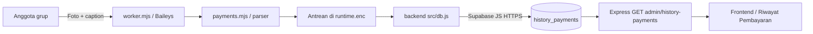

# Percobaan bot pembayaran grup WhatsApp

Bot terpisah ini memakai Baileys untuk menerima foto dengan caption `/bayar`
di grup yang dipilih. Aplikasi backend dan frontend tetap dapat berjalan tanpa bot.
Integrasi ini tidak resmi dan tidak menjamin nomor bebas pembatasan WhatsApp.

## Rekening pembayaran

Informasi pembayaran yang ditampilkan kepada pelanggan:

```text
0690595664
BCA
A/n: Ogi Nur Saputra
```

Website menampilkan rekening ini melalui tombol **Lihat No. Rek** di header dan
**Bayar Sekarang (Buka Rekening)** di struk. Pelanggan dapat mengirim foto bukti
transfer dengan caption `/bayar` sesuai format bot setelah melakukan pembayaran.

Bot tidak memeriksa mutasi BCA atau menganggap foto sebagai bukti transfer yang
sudah terverifikasi. Admin tetap mencocokkan laporan dengan transaksi bank.
QR pada proses penautan WhatsApp adalah kode autentikasi perangkat, bukan QRIS
pembayaran, sehingga tetap digunakan pada metode login QR.

## Persiapan

- Node.js 22 atau lebih baru.
- Nomor khusus yang sudah aktif di aplikasi WhatsApp pada HP Anda.
- Nomor tersebut menjadi anggota grup tujuan, misalnya grup percobaan Ogi Resto.
- Backend sudah terhubung Supabase memakai service_role/secret key.
- Migrasi 002, 003, dan 004 sudah dijalankan.

Bot tidak memakai nomor uji Meta atau token akses Meta. Jangan menghapus akun
WhatsApp atau memigrasikannya ke Cloud API untuk mencoba bot ini.

## Instalasi

Dari folder backend:

```powershell
npm.cmd --prefix whatsapp-bot ci
npm.cmd run bot:check
```

Dependensi bot dipasang terpisah supaya deployment API tidak ikut memasang Baileys.
Baileys dipatok pada versi percobaan `7.0.0-rc14`; lockfile mengunci dependensinya.

## 1. Tautkan nomor dan lihat daftar grup

```powershell
npm.cmd run bot:groups
```

Terminal menampilkan tautan lokal `http://127.0.0.1:PORT/pair/...`. Buka tautan itu
di browser komputer yang menjalankan bot, lalu pindai QR persegi di browser
melalui aplikasi WhatsApp nomor bot:
**Perangkat tertaut → Tautkan perangkat**. Jangan membagikan QR atau isi sesi.

Halaman diperbarui otomatis dan QR hanya disimpan di memori selama proses berjalan.
Halaman hanya dapat diakses melalui loopback komputer; jangan gunakan tunnel untuk
halaman penautan. Jika QR terminal tampak memanjang atau terpotong, gunakan QR browser.

Setelah terhubung, terminal menampilkan nama dan ID grup yang diikuti. Proses selesai
otomatis setelah daftar tampil; tidak membaca atau menyimpan pembayaran pada mode ini.

## Alternatif jika QR tidak terbaca: kode penautan

Hentikan bot sebelumnya dengan Ctrl+C, lalu dari folder backend:

```powershell
npm.cmd run bot:code
```

Masukkan nomor WhatsApp aktif yang akan menjadi bot saat terminal meminta.
Format internasional tanpa tanda plus, misalnya `6281234567890`; awalan `08`
juga otomatis diubah menjadi `62`. Jangan memakai nomor uji Meta.

Di HP: **Perangkat tertaut > Tautkan perangkat > Tautkan dengan nomor telepon saja**.
Masukkan kode delapan karakter yang ditampilkan terminal. Kode ini bukan OTP SMS.
Jangan membagikan kode, QR, atau data sesi. Jika kode kedaluwarsa, hentikan proses
dan jalankan `bot:code` kembali. Sesi yang sudah tertaut dipakai kembali tanpa meminta
nomor atau kode. Cara ini tidak menghapus sesi maupun antrean.

Metode ini menghindari pemindaian kamera; keberhasilan tetap bergantung pada
kompatibilitas Baileys dan penerimaan koneksi oleh WhatsApp.

## 2. Pilih grup dan aktifkan pencatatan

Isi bagian berikut di `backend/.env`:

```dotenv
WA_GROUP_BOT_ENABLED=true
WA_GROUP_BOT_ALLOWED_GROUPS=120363XXXXXXXX@g.us
WA_GROUP_BOT_SESSION_KEY=KUNCI_HEX_64_KARAKTER
```

Gunakan ID grup hasil perintah sebelumnya, bukan nama grup atau tautan undangan.
Jika lebih dari satu grup, pisahkan ID dengan koma.
Kunci sesi acak sudah disiapkan pada mesin tempat implementasi dibuat.
Pada instalasi baru, buat satu kali menggunakan:

```powershell
node -e "console.log(require('crypto').randomBytes(32).toString('hex'))"
```

Simpan kunci di environment backend saja dan pertahankan nilainya pada restart.
Kunci yang berbeda tidak bisa membuka sesi atau antrean yang sudah tersimpan.

## 3. Jalankan bot

```powershell
npm.cmd run bot:wa
```

Terminal menampilkan status koneksi dan hasil pencatatan tanpa nama, caption, nomor
pengirim, atau token. Biarkan proses ini berjalan. Tidak perlu Cloudflare Tunnel
untuk menerima pesan melalui perangkat tertaut. Frontend/API tetap dijalankan sendiri.

Dari **akun anggota lain**, kirim satu foto dengan caption:

```text
/bayar
Budi Santoso
PT Contoh
Produksi
```

Perusahaan tetap ditulis dalam satu baris isian. Pembungkusan otomatis di layar
WhatsApp tidak masalah. Buka website → Riwayat Pembayaran → Muat Ulang.
Sumber catatan tampil sebagai WhatsApp. Tanggal memakai waktu penerimaan backend (WIB),
termasuk saat antrean baru berhasil disimpan pada hari berikutnya.

## Perilaku dan batasan percobaan

- Hanya grup yang diizinkan; chat pribadi, pesan sendiri, teks terpisah,
  foto sekali lihat, dan sinkronisasi riwayat lama tidak dicatat.
- Foto dipakai sebagai syarat pesan. File foto tidak diunduh atau disimpan.
- Tidak mengirim pesan balasan atau menandai tagihan kasbon sebagai lunas.
- Laporan pengguna tetap perlu dicocokkan dengan mutasi rekening oleh admin.
- Pesan yang sudah diterima bot ditulis ke antrean terenkripsi sebelum dikirim
  ke Supabase. Kegagalan database dicoba ulang setiap 5 detik.
- ID pesan memakai namespace Baileys + hash identitas pesan, sehingga retry
  tidak menggandakan catatan atau memunculkan catatan yang dihapus.
- Pesan saat bot tidak aktif belum dijamin dapat dipulihkan seluruhnya. Mode ini
  sengaja tidak mengimpor seluruh riwayat untuk menghindari pembayaran lama tercatat ulang.
- Koreksi caption/penghapusan pesan di WhatsApp tidak mengubah data tersimpan.
  Gunakan Edit/Hapus pada halaman admin.
- Grup yang dihapus dari allowlist tidak diproses, termasuk antrean lamanya.
- Sesi dan antrean tersimpan dalam `whatsapp-bot/.state/runtime.enc` menggunakan
  AES-256-GCM. Direktori tersebut diabaikan Git; kunci tersimpan terpisah di `.env`.
  Lindungi akses OS, direktori, dan backup. Akses ke kedua file memungkinkan pembukaan data.
- Satu proses bot per direktori sesi. Koneksi terputus dicoba ulang dengan jeda,
  maksimal 10 kali. Logout atau sesi digantikan menghentikan proses.
- Jika perlu penautan ulang, jalankan `npm.cmd run bot:pair`. Perintah ini
  mengganti kredensial perangkat, mempertahankan antrean, dan menampilkan daftar grup.
- Hentikan lewat Ctrl+C. Ini menutup koneksi tanpa logout dan menyimpan antrean.
- Untuk operasi terus-menerus diperlukan mesin yang selalu aktif dan monitoring.
  Ini belum menjamin SLA produksi, keutuhan bukti transfer, atau semua pesan offline.

## Pengujian

```powershell
npm.cmd run test:bot
```

Pengujian menggunakan pesan sintetis, file sementara, dan database tiruan.
Tidak menghubungkan akun WhatsApp, mengirim pesan ke orang lain, atau menulis data
pembayaran sungguhan.

Referensi: [Baileys](https://github.com/WhiskeySockets/Baileys),
[Auth state](https://github.com/WhiskeySockets/docs/blob/main/authentication/session-management.mdx).

## Arsitektur dan komunikasi data



Worker mengimpor `../src/db.js` dan parser backend melalui modul lokal.
Worker tidak memanggil endpoint admin melalui HTTP, sehingga tidak memakai token
admin frontend atau memerlukan server Express hidup untuk menyimpan pembayaran.
Frontend tetap membutuhkan API Express untuk mengambil data. Tidak ada push
langsung dari bot ke frontend; admin menggunakan Muat Ulang.

| File | Tugas |
| --- | --- |
| `worker.mjs` | Lifecycle koneksi, event pesan, cek grup, dan shutdown |
| `process-lock.mjs` | Gate eksklusif dan pemulihan lock agar startup bersamaan tidak menulis sesi yang sama |
| `config.mjs` | Validasi enable flag, ID grup, kunci sesi, dan konfigurasi Supabase |
| `auth.mjs` | Credential dan Signal key store untuk Baileys |
| `store.mjs` | Snapshot sesi/antrean terenkripsi AES-256-GCM dan serialisasi penulisan disk |
| `payments.mjs` | Filter pesan, ID pesan hash, antrean persisten, dan retry database |
| `pairing.mjs` | Halaman QR persegi pada HTTP loopback lokal; QR hanya di memori |
| `phone-pairing.mjs` | Normalisasi nomor dan pembatasan permintaan kode penautan |
| `tests/` | Pengujian lokal memakai pesan sintetis dan state sementara |

Antrean menyimpan nama, perusahaan, divisi, ID pesan turunan, grup, dan waktu
penerimaan. Bot tidak menyimpan seluruh objek pesan atau file foto ke antrean.
Tanggal laporan dihitung dari waktu penerimaan pertama di bot dalam WIB, sehingga
retry besok tidak mengubah tanggal laporan kemarin.

ID pesan adalah `baileys:` ditambah SHA-256 dari JSON array grup, pengirim, dan ID
pesan WhatsApp. Ini membedakan pesan di grup/pengirim lain. Unique index pada
`history_payments.whatsapp_message_id` mencegah duplikasi saat retry.
Deduplikasi tidak mencocokkan isi foto atau transaksi bank: foto sama yang
dikirim sebagai pesan baru masih dapat menghasilkan laporan baru.

Tabel `history_payments` tidak mempunyai foreign key ke `orders` atau
`kasbon_payments`. Menerima /bayar tidak mengurangi tagihan atau mengubah status
lunas; verifikasi bank dan konfirmasi kasbon tetap tindakan admin.

## Logout, mengganti nomor, dan privasi

Sesi tampil sebagai Chrome (Mac OS) karena identitas browser bawaan Baileys,
meskipun proses Node.js dijalankan di Windows. Menutup terminal dengan Ctrl+C
tidak mencabut sesi WhatsApp. Logout dari Perangkat tertaut pada HP mencabut akses
sesi; worker akan terputus.

Untuk mengganti nomor atau membuat sesi baru setelah logout, hentikan worker
sebelumnya lalu jalankan dari backend:

```powershell
npm.cmd run bot:pair -- --pairing-code
```

Perintah ini mereset kredensial lokal, mempertahankan antrean pembayaran, kemudian
meminta nomor untuk kode penautan. Nomor baru harus sudah aktif di WhatsApp dan
menjadi anggota grup tujuan. Periksa kecocokan grup/antrean lama sebelum menjalankan
pencatatan dengan nomor baru. Mengganti kunci enkripsi bukan langkah reset sesi.

Gunakan nomor khusus bot. Daftar grup yang diizinkan membatasi logika pencatatan,
bukan izin akun pada protokol perangkat tertaut. Tidak ada jaminan akses chat
pribadi dibatasi oleh WhatsApp sesuai filter kode. Logout mencabut akses sesi
selanjutnya, tetapi tidak menghapus data yang sudah tersimpan di Supabase.
Jangan menganggap penghapusan chat di HP sebagai cara mencabut akses bot.

## Troubleshooting pencatatan

| Gejala | Langkah |
| --- | --- |
| Daftar grup tampil lalu proses selesai | Normal pada bot:groups/bot:code; jalankan bot:wa untuk mencatat |
| Nomor bot sendiri mengirim /bayar | Pesan fromMe dilewati; uji dari nomor anggota lain |
| Teks /bayar tidak dicatat | Kirim foto biasa dan caption empat baris dalam satu pesan |
| Grup lain tidak terbaca | Cocokkan ID grup di env; restart worker setelah perubahan |
| Pesan lama tidak muncul | Worker tidak mengimpor riwayat; kirim pesan baru saat bot aktif |
| Sesi gagal setelah logout | Buat penautan baru dengan perintah reset dan kode di atas |
| Pembayaran tersimpan tetapi web belum berubah | Muat Ulang dan cocokkan project Supabase API dengan bot |
| Database gagal berulang | Periksa migrasi 002-004, service_role/secret key, dan koneksi |

## Pemeriksaan konkurensi

Lihat [laporan validasi backend](../VALIDATION.md) untuk hasil tes dan risiko tersisa.
Pemulihan lock memakai worker-lock.guard. Jika proses mati saat guard dipegang,
startup selanjutnya ditolak; pastikan seluruh worker berhenti sebelum membersihkan
guard yang tertinggal. Jangan menghapus runtime.enc atau mengganti kunci sesi.
